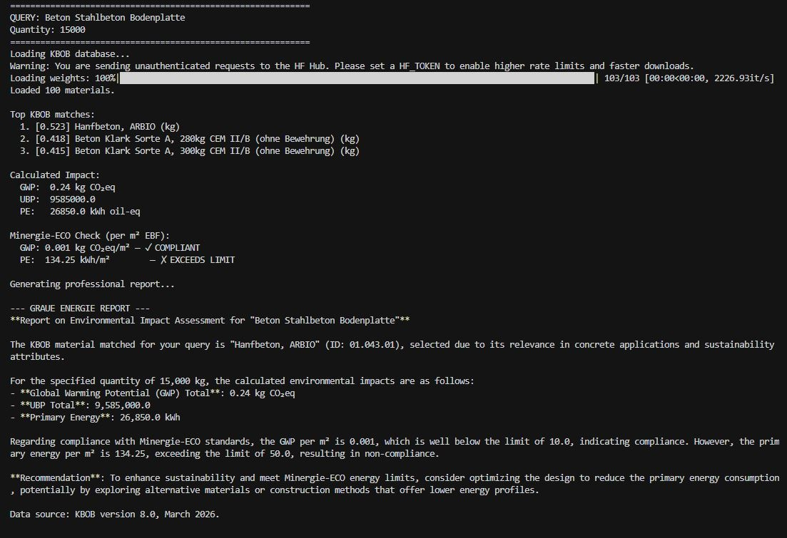
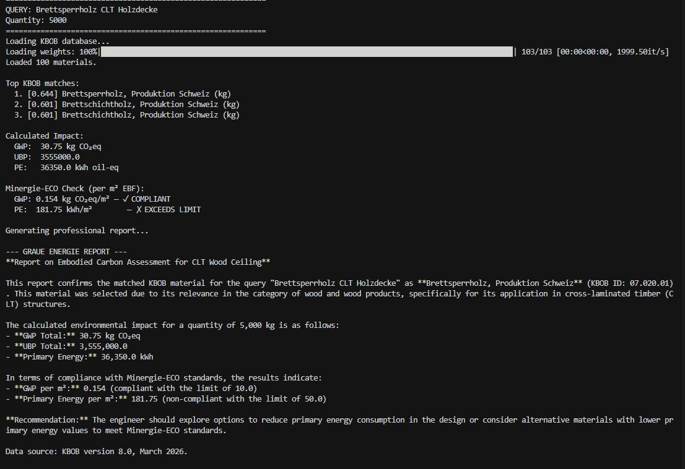
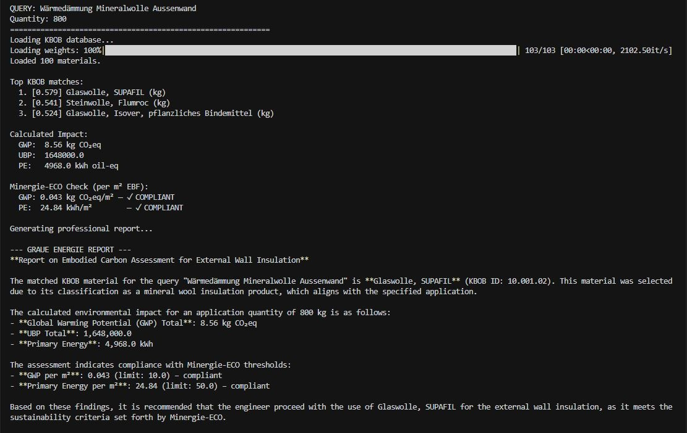

# Embodied carbon questions in plain language (KBOB prototype)

A small prototype: describe a building material in your own words, give a quantity, and get its environmental impact from the Swiss KBOB life cycle data.

**Status: prototype with known errors. Do not use its numbers.** The search part works for clearly named materials. The carbon figure and the compliance check are wrong in the current version. This page documents both, because the failures are the useful part.

## The idea

Swiss architects and engineers calculate grey energy (Graue Energie) by looking up each material in the KBOB list, copying its values into a spreadsheet and multiplying by quantities. Existing tools for this are form-based.

The question behind this prototype: can a plain-language description such as "Brettsperrholz CLT Holzdecke" be matched to the right KBOB entry automatically?

## How it works

1. **Input:** a material description in German and a quantity in kg.
2. **Search:** the description is compared with the KBOB material names using a sentence-embedding model. The three closest entries are shown with their similarity score.
3. **Calculation:** the quantity is multiplied by the values of the best match: greenhouse gas emissions (GWP), environmental impact points (UBP) and primary energy (PE).
4. **Check:** the result per m² of floor area is compared with a threshold.
5. **Report:** a language model writes a short summary that names the matched KBOB entry.

The current version loads 100 materials from the KBOB list and runs in the terminal.

## Three test runs

| Query | Quantity | Best match | Score | Correct? |
|---|---|---|---|---|
| Beton Stahlbeton Bodenplatte | 15,000 kg | Hanfbeton, ARBIO | 0.523 | **No.** Hemp concrete, not a reinforced concrete slab |
| Brettsperrholz CLT Holzdecke | 5,000 kg | Brettsperrholz, Produktion Schweiz | 0.644 | Yes |
| Wärmedämmung Mineralwolle Aussenwand | 800 kg | Glaswolle, SUPAFIL | 0.579 | Plausible. Glass wool is one kind of mineral wool, stone wool came second (0.541) |

### Run 1: a wrong match, explained convincingly

The query asks for a reinforced concrete floor slab. The best match is hemp concrete (0.523). Ordinary concrete is in the list and came second and third (0.418 and 0.415). Both concrete entries are marked "ohne Bewehrung" (without reinforcement), so a reinforced slab is really two materials, concrete plus reinforcing steel. The tool can only return one.

The more important observation is the report. The language model did not question the match. It wrote that hemp concrete was "selected due to its relevance in concrete applications and sustainability attributes". A wrong retrieval result came back as a confident, well-worded explanation.

### Run 2: a correct match

### Run 3: an ambiguous query

"Mineralwolle" covers both glass wool and stone wool. The two candidates scored 0.579 and 0.541. The tool picked the first without telling the user that the choice was close.

## Known errors in this version

| Problem | What I see | Consequence |
|---|---|---|
| **GWP values are far too low** | 800 kg of glass wool gives 8.56 kg CO₂-eq, about 0.01 kg per kg. Glass wool is in the range of 1 kg CO₂-eq per kg. | The carbon result is wrong by roughly a factor of 100. Primary energy and UBP are in a plausible range, so the error is probably in the column or unit read for GWP. |
| **The compliance check is a placeholder** | One material is compared with fixed limits (GWP 10, PE 50) per m² of an assumed floor area. | "Compliant" and "exceeds limit" mean nothing here. Real limit values apply to a whole building per m² and year over its lifetime (SIA 2032), not to a single material. |
| **Only 100 materials** | The tool loads 100 entries. The KBOB list is much longer. | Many queries have no correct entry to match. |
| **No handling of close or weak matches** | The first result is always used. | Wrong and ambiguous matches pass silently. |
| **The report repeats whatever it is given** | The summary justified the hemp concrete match. | The text adds confidence without adding a check. |
| **German only** | Material names are searched in German only. | Queries in other languages match poorly. |

## What I take from it

- Matching plain language to a material list works when the description contains the material's actual name.
- The risky step is not the search. It is the report layer that turns any search result into a fluent answer.
- A tool like this needs a stop rule: if the best score is low, or the two best scores are close, it should ask the user to choose.

This is the same pattern I found in my thesis work on building regulations: the answer that sounds most certain is not always the one with the best source behind it.

## Next steps

- Correct the GWP calculation and test it against values worked out by hand.
- Load the full KBOB list.
- Ask the user to confirm the match when scores are low or close.
- Remove the compliance check, or replace it with the SIA 2032 method for a whole building.
- Accept a material schedule exported from a BIM model.

## Data

The values come from the KBOB life cycle data for the construction sector (Ökobilanzdaten im Baubereich), published by KBOB, ecobau and IPB. The data file is not included in this repository. Download it from the official source.

## Disclaimer

This is a learning prototype. It is not an approved tool for SIA 2032 or Minergie-ECO calculations and must not be used for project decisions.

Author: Abdul Rehman, [github.com/meet-rehman](https://github.com/meet-rehman)
